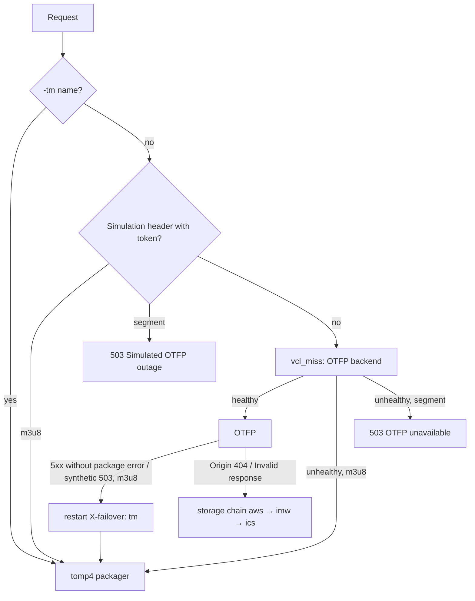

# Fastly: fail over from OTFP to the tomp4 packager

> **Parked (2026-10-27):** not deployed. Fastly OTFP was fixed, so this is kept for reference only.
> See `docs/plans/2026-10-26-otfp-compatible-packager.md`.

`svod-otfp-failover.vcl` is the svod / invintus-otfp service's custom VCL with failover added. It's
written against the generated VCL on 2026-10-26. Everything except the marked additions is the
existing logic.

## What was wrong before

1. The backups (`aws` / `imw` / `ics`) only change `X-Fastly-Origin`, the storage the packager reads.
   Every one still runs through the same Fastly packager, so none can cover a packager outage.
2. The restart only fires on `X-Fastly-Package-Error` "Origin 404" / "Invalid response from origin".
   It never fires on "503 No healthy backends", other 5xx, or timeouts.
3. 5xx were cached with `stale_if_error 5m`, so the edge served the error itself as stale content.
4. The packager's health is invisible: the four `127.0.0.1` backends only enable shielding, and the
   real backend is inside the managed snippet.

## How the failover works

- The packager serves the same request URLs but names its variants `{x}-tm.m3u8` and its segments
  `{x}-tm{n}.ts`. `-tm` URLs always go to it, so a session stays on the packager that built its
  playlist. OTFP-named segments are never served by it (different cut points).
- Playlists served on OTFP URLs during a failover are cached for 60 s, so the service returns to OTFP
  shortly after it recovers. `-tm` URLs keep 6 h (they're immutable).
- A session whose packager dies mid-playback gets a segment error. The player retries, reloads the
  playlist, and lands on the other packager.

## Setup (in this order: the VCL won't compile without the backend and dictionary)

1. **Deploy the packager** (`packager/Dockerfile`) behind HTTPS, e.g. ECS Fargate + ALB.
   `ORIGIN_BASE=https://s3.us-east-005.backblazeb2.com/invintus-client-media/`. Optionally restrict
   ingress to Fastly's IP ranges.
2. **Pick the right service.** It must be the one serving `invintus-otfp.global.ssl.fastly.net`,
   the CDN root PublicAPI's `fastlyVod()` requests, as well as `svod.*`. Check its domains and test
   domains. **Clone** the active version and work in the clone.
3. **Health check** `tomp4_healthz`: GET `/healthz`, host = the packager hostname, expected 200,
   interval 5 s, timeout 2 s, window 5, threshold 3, initial 4.
4. **Backend** `tomp4_packager` (VCL name `F_tomp4_packager`):
   - Address = the packager hostname, port 443, TLS on, certificate hostname and SNI = that hostname,
     override host = that hostname.
   - Shielding: `iad-va-us` (same shield as OTFP).
   - Health check: `tomp4_healthz`. Timeouts: connect 1 s, first byte 15 s, between bytes 10 s.
   - Request condition `packager_route`: `req.http.X-Packager-Route == "1"`. This keeps it from
     becoming the default backend; the VCL sets that header.
5. **Edge dictionary** `packager_cfg` (write-only):
   - `failover` = `on`: the kill switch; `off` restores today's behaviour without a deploy.
   - `simulate_token` = a long random string.
6. **Move the storage keys** out of the readable `otfp` table into a write-only dictionary (they
   appear in generated VCL), and rotate them: they were pasted into a chat on 2026-10-26.
7. **Upload** `svod-otfp-failover.vcl` as the main custom VCL, then **validate** the version.
8. **Activate.** To roll back, activate the previous version.

## Verify

`T=<simulate_token>`, `H=https://svod.invintus.com`, `A=a6cbce3c66d8e7019c41e797f370aba568b8290a`
(client `2147483647`, event 2026101011).

| Check | Command | Expect |
|---|---|---|
| Packager direct | `curl -s https://<packager-host>/healthz` | `{"ok":true,…}` |
| Simulated outage, master | `curl -s -H "X-Simulate-Otfp-Down: $T" "$H/2147483647/$A,${A}_720p_30fps/master.m3u8"` | 200, `X-Packager: tomp4`, variant URLs `https://svod.invintus.com/2147483647/…-tm.m3u8` |
| Simulated, single file | `curl -s -H "X-Simulate-Otfp-Down: $T" "$H/2147483647/${A}_360p_30fps.m3u8"` | Media playlist with `…-tm1.ts` lines |
| Simulated, OTFP segment | `curl -s -o /dev/null -w '%{http_code}' -H "X-Simulate-Otfp-Down: $T" "$H/2147483647/${A}_360p_30fps-1.ts"` | 503 |
| -tm segment | `curl -s -o /dev/null -w '%{http_code} %{content_type}' "$H/2147483647/${A}_360p_30fps-tm1.ts"` | 200 `video/mp2t` |
| Wrong token | `curl -sI -H "X-Simulate-Otfp-Down: nope" "$H/2147483647/${A}_360p_30fps.m3u8"` | Normal OTFP path (no `X-Packager`) |
| Not cached | Repeat the simulated master, then the same URL without the header | The unsimulated response doesn't carry `X-Packager` (while OTFP is healthy) |
| Real outage (today) | `bash .claude/plans/hotfixes/20261026/repro-vod-streamuri-404.sh` (hosted-player) | Step 2 `StreamURI` returns 200, not 404 |
| Player | ktoo.org event page, or hosted-player `?src=` with the simulated master | Plays; seek works |
| Kill switch | `packager_cfg.failover = off` | Back to OTFP-only behaviour |

**Not validated here:** the VCL hasn't been compiled. There's no Fastly CLI or account access in the
environment it was written in. Compile it with the UI's Validate step (or `fastly vcl custom` plus
version validate) before activating.
